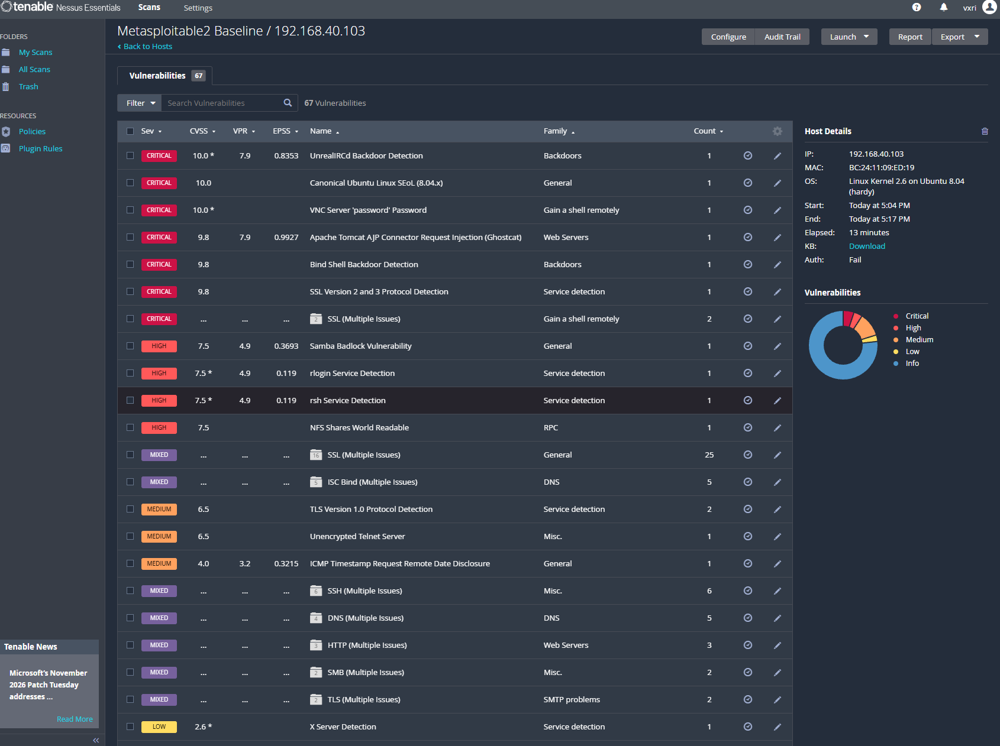
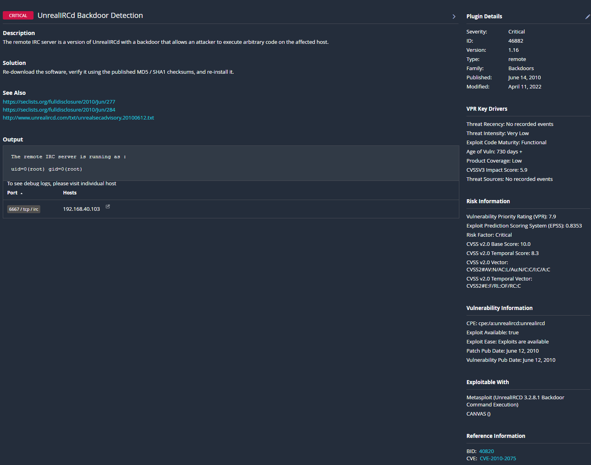
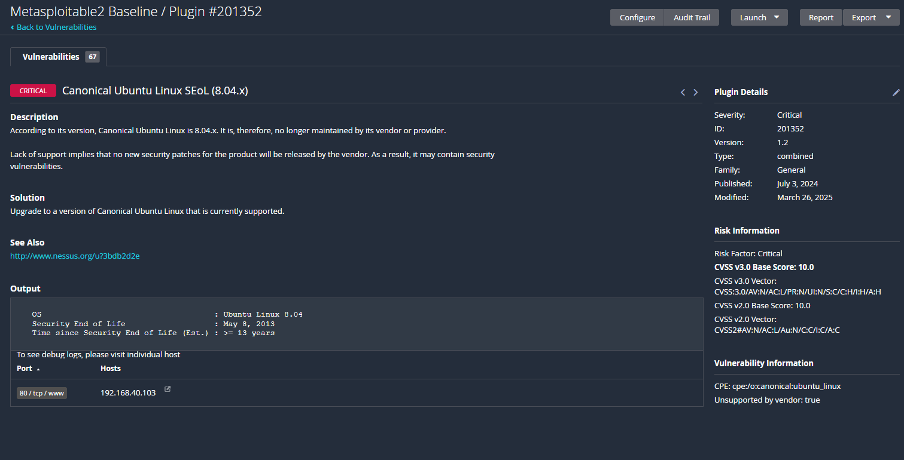
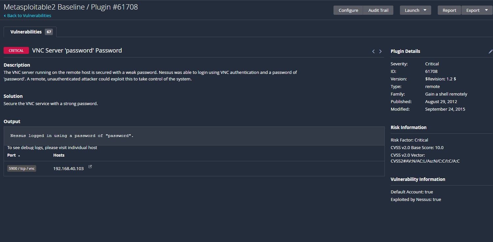
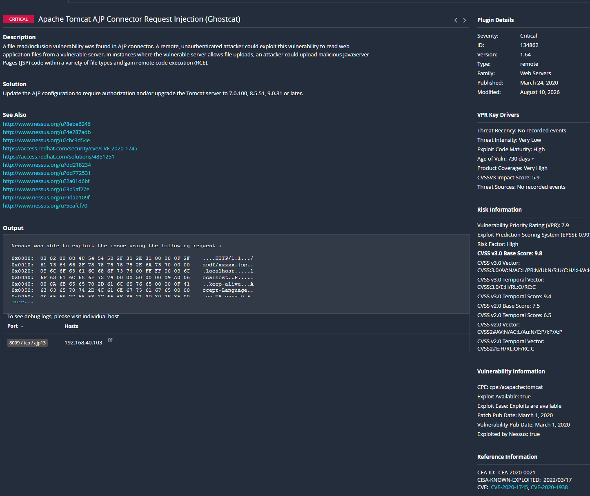
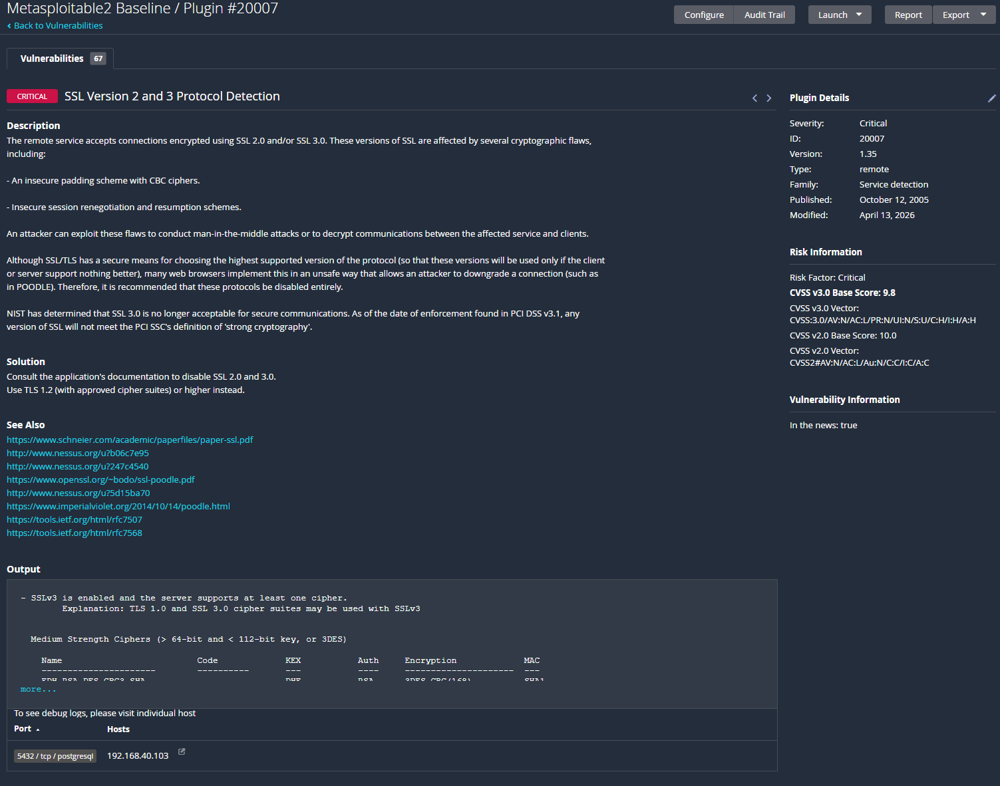
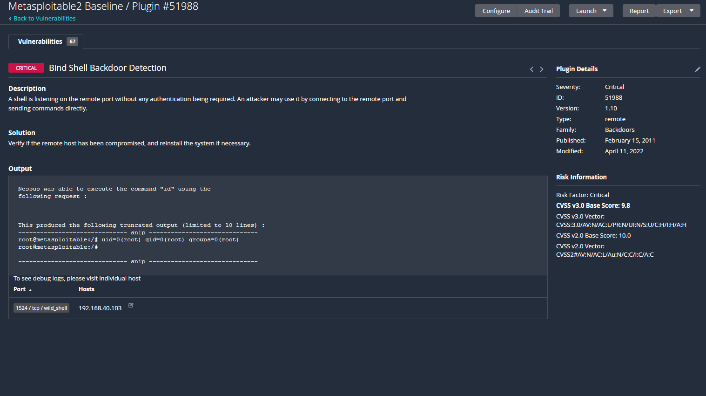
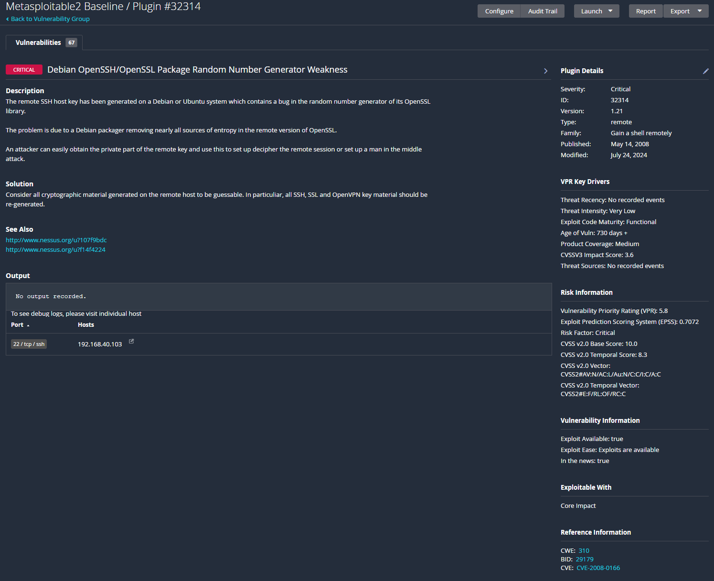

# Vulnerability Assessment: Metasploitable2

## Overview

Unauthenticated vulnerability scan of Metasploitable2, an intentionally vulnerable Linux VM, running in an isolated home lab on Proxmox. Goal: identify and prioritize vulnerabilities and write up remediation steps, as practice for real-world vulnerability management workflows.

## Methodology

- **Scanner:** Nessus Essentials
- **Scan type:** Basic Network Scan (unauthenticated)
- **Target:** 192.168.40.103 (Metasploitable2)
- **Scope:** Single host, isolated lab network, no production systems involved

## Scan Summary

The scan identified 67 unique vulnerabilities on the host, totaling 99 instances when counted across all affected ports and services:

| Severity | Count |
|----------|-------|
| Critical | 5 |
| High | 4 |
| Medium | 11 |
| Low | 3 |
| Informational | 76 |

## Executive Summary

An unauthenticated vulnerability scan of Metasploitable2 (192.168.40.103) identified 67 unique vulnerabilities across the host, totaling 99 instances when counted across the affected ports and services: 5 Critical, 4 High, 11 Medium, 3 Low, and 76 Informational.

The most severe discoveries were two active, unauthenticated backdoors (UnrealIRCd and a bind shell on port 1524), both of which allow root access with no credentials needed, a weak VNC password that was successfully used by the scanner to log in, and a known-exploited Apache Tomcat vulnerability called Ghostcat (CVE-2020-1938). The host runs Ubuntu 8.04, which has been unsupported since 2013, meaning none of these vulnerabilities will ever receive an official vendor patch without a full OS upgrade.

## Detailed Findings

### 1. UnrealIRCd Backdoor Detection (Critical, CVSS 10.0)
**CVE:** CVE-2010-2075
**Port:** 6667/tcp (IRC)

The IRC server is running a compromised version of UnrealIRCd that contains a backdoor, which makes it extremely easy for an attacker to execute code and potentially gain full root access to the system. This was a supply-chain compromise: the backdoor was inserted into the official distribution around 2009, so anyone who downloaded the software after that point was compromised regardless of their own configuration. The fix is to re-download UnrealIRCd from the verified official source in its most recent version and reinstall.

### 2. Canonical Ubuntu Linux SEoL (8.04.x) (Critical, CVSS 10.0)
**Port:** 80/tcp (and system-wide, since this applies to the OS itself)

The host is running Ubuntu 8.04, which reached end of life in May 2013, over 13 years ago at the time of this scan. Since the vendor no longer supports this version, it receives no further security updates at all, meaning any vulnerability discovered since 2013 remains permanently unpatched. The fix is to upgrade to a currently supported OS version so the system can receive up-to-date security patches and recommendations.

### 3. VNC Server 'password' Password (Critical, CVSS 10.0)
**Port:** 5900/tcp (VNC)

The VNC remote desktop service is secured with the password "password". Nessus confirmed this isn't theoretical, it actually authenticated to the service using that password. VNC grants full remote desktop control, so this weak credential could let a malicious actor get into the system very easily with direct access. The fix is to set a strong, unique password for the VNC service, or disable VNC entirely if it's not in use.

### 4. Apache Tomcat AJP Connector Request Injection — Ghostcat (Critical, CVSS 9.8)
**CVE:** CVE-2020-1938 (also referenced as CVE-2020-1745)
**Port:** 8009/tcp (AJP)
**CISA KEV:** Listed as a Known Exploited Vulnerability (added 2022-03-17)

The Tomcat AJP connector has a file read/inclusion flaw that lets a malicious actor read arbitrary web application files. If the server also allows file uploads, an attacker can chain this with a malicious file upload to gain code execution and take over the system. This is known as "Ghostcat," and it's actively listed on CISA's Known Exploited Vulnerabilities catalog. The fix is to upgrade to the latest version of Tomcat, which secures the AJP connector by default, or disable the connector if it isn't needed.

### 5. SSL Version 2 and 3 Protocol Detection (Critical, CVSS 9.8)
**Port:** 5432/tcp (PostgreSQL)

The PostgreSQL service accepts connections using SSL 2.0/3.0, both of which have known flaws, including insecure session renegotiation that fails to properly verify the connecting party. This can let an attacker perform a man-in-the-middle attack or decrypt data traveling between a user and the service. This finding is more of a weakness than a flaw, meaning the fix doesn't require a vendor patch, just a configuration change to disable the outdated protocols and require TLS 1.2 or higher.

### 6. Bind Shell Backdoor Detection (Critical, CVSS 9.8)
**Port:** 1524/tcp (wild_shell)

A command shell is listening on this port with no authentication required at all. Anyone who connects to this port can send commands directly and have them executed. Nessus confirmed this by running the `id` command through the open shell and found it returned complete root-level access. This is like having a car with no doors, the key left in the ignition, and a sign that says "free ride." Because this is such a severe vulnerability, if an attacker already found this, the recommendation is to rebuild the system entirely, since the attacker could have already planted additional backdoors even if this one gets patched.

### 7. Debian OpenSSH/OpenSSL Package Random Number Generator Weakness (Critical, CVSS 10.0)
**CVE:** CVE-2008-0166
**Port:** 22/tcp (SSH)

The host's SSH key was generated on a Debian-based system affected by a 2006-2008 packaging bug that stripped nearly all entropy sources from OpenSSL's random number generator. This made the pool of possible private keys small enough to be enumerable. This isn't a guessable password, it's a fundamental weakness in how the key itself was created, so any key generated on this system should be assumed compromised. The fix is to patch OpenSSL to the latest version first, then regenerate all keys.

